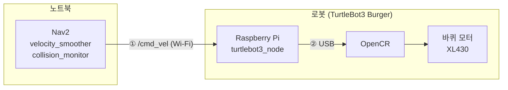

# ROS 2 로봇 통신 고장 대응

ROS 2 로봇(TurtleBot3)에서 명령이나 모터 통신이 끊길 때 로봇이 어떻게 움직이는지 시뮬과 실물로 재현하고 드라이버를 고친 뒤 전후를 잰다.

> **In short:** Reproducing, fixing and measuring how a real ROS 2 robot (TurtleBot3) behaves when commands, Wi-Fi or the motor link drop out, in Gazebo and on hardware.

## 문제

Nav2의 방어 장치는 노트북에서 돌기 때문에 Wi-Fi가 끊기면 로봇을 세울 수 없다. 로봇 쪽 드라이버도 마지막으로 받은 속도를 그대로 쓴다.

| | 고장 | 현재 동작(①②는 소스 기준) | 대응 방향 |
| --- | --- | --- | --- |
| ① | 노트북 → 로봇 명령 끊김 | 마지막 속도를 계속 쓴다 | `cmd_vel_timeout` (0 = 끔) |
| ② | 로봇 컴퓨터 → OpenCR 읽기 실패 | 오류 로그만 남기고 마지막 값에 지금 시각을 붙여 계속 낸다 | `read_timeout` (0 = 끔) |
| ③ | Wi-Fi · ROS 2 통신 품질 저하 | 명령이 늦거나 띄엄띄엄 올 수 있다 | `link_monitor`로 `/diagnostics`에 알림 |

①의 문제와 수정 방식은 [turtlebot3 이슈 #1154](https://github.com/ROBOTIS-GIT/turtlebot3/issues/1154)에서 먼저 보고되고 제안됐다. 여기서는 이 문제를 실물로 재현하고 수정 방식을 구현해 시험한 뒤 권장값을 측정 근거와 함께 낸다.

## 접근 방법

1. **기존 방어 장치 확인**: Nav2 · 드라이버 · 펌웨어가 어디까지 막는지 표로 정리한다.
2. **시뮬에서 먼저 재현**: 같은 고장을 Gazebo에 넣어 본다.
3. **실물에서 재현**: 받침대에서 시작해 바닥으로 옮긴다.
4. **빈 곳만 수정**: 기본 동작은 바꾸지 않고 파라미터로 켜는 시간 초과 기능을 더한다.
5. **전후 측정**: 같은 절차로 정지 시간과 거리, 잘못 멈춘 횟수를 잰다.
6. **시뮬 보정과 값 선택**: 실측으로 시뮬을 맞추고 시간 초과 값을 고른 뒤 실물로 확인한다.

## 두 갈래

| 갈래 | 다루는 것 | 문서 |
| --- | --- | --- |
| 이동 · 통신 | 명령 · Wi-Fi 끊김, 실물에 맞춘 시뮬, 통신 상태 감시, Nav2 실물 주행 | [mobile-track](docs/mobile-track.md) |
| 구동 · 드라이버 | OpenCR · DYNAMIXEL 통신 고장, ros2_control 실물, 가짜 장치를 쓴 드라이버 시험 | [actuator-track](docs/actuator-track.md) |

## 만드는 것

| 구성 | 역할 |
| --- | --- |
| 고장 주입 | 속도 명령을 중계하면서 끊거나 늦추거나 버린다. 시뮬과 실물에서 같은 노드를 쓴다 |
| 측정 도구 | rosbag에서 정지 시간 · 거리와 메시지 간격 분포를 뽑는다 |
| 판단 로직 | 시간 초과 판단과 고장 상태 전이를 ROS와 분리해 단위 테스트한다 |
| 드라이버 수정 | `cmd_vel_timeout`, `read_timeout`, `/diagnostics` 알림 |
| 실물에 맞춘 시뮬 | 측정한 가감속 · 지연을 Gazebo 바퀴 모델에 반영하고 전후 차이를 비교한다 |
| ros2_control | `dynamixel_hardware_interface`로 모터를 돌리고 USB 끊김과 Bus Watchdog을 시험한다 |
| 가짜 장치 | DYNAMIXEL Protocol 2.0 응답을 흉내 내어 실물 없이 드라이버 고장을 시험한다 |
| 통신 감시 | 통신 상태를 재고 나빠지면 `/diagnostics`로 알린다 |

## 범위와 한계

- **안전 등급 기능이 아니다.** 위험 분석과 인증을 거치지 않았다.
- 로봇 한 대, 실내, 저속, 집 공유기 하나에서만 시험한다.
- 하지 않기로 한 것과 이유는 [not-doing](docs/not-doing.md)에 있다.

## 문서

| 문서 | 내용 |
| --- | --- |
| [fault-table](docs/fault-table.md) | 고장 분석표 |
| [requirements](docs/requirements.md) | 요구사항과 합격 기준 |
| [test-procedure](docs/test-procedure.md) | 시험 절차와 숫자 쓰는 법 |
| [decisions](docs/decisions/) | 설계 결정 기록 |
| [diagnosis-notes](docs/diagnosis-notes.md) | 실제로 겪은 문제의 진단 기록 |

## 환경

Ubuntu 24.04 · ROS 2 Jazzy · Gazebo Harmonic · TurtleBot3 Burger (OpenCR, XL430-W250)

## 라이선스

[Apache-2.0](LICENSE)
